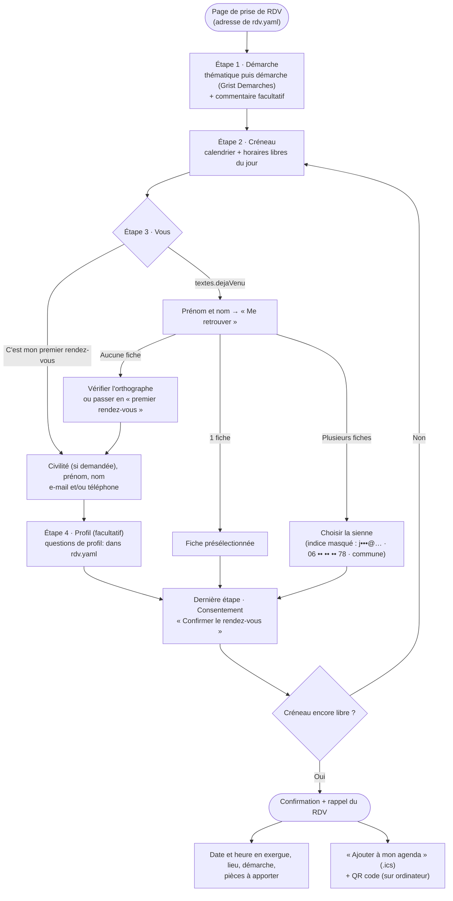

# Plugin « rdv » : prise de rendez-vous en ligne

Formulaire public de prise de rendez-vous individuel (accompagnement,
permanence, conseil…) : la personne choisit une démarche, un créneau, se
présente, et le RDV est enregistré **directement dans un document Grist** de
l'association — aucune saisie à reprendre ensuite.

Le plugin est **générique** : adresse de la page, textes, durée des créneaux,
questions posées, permanences, logo… tout ce qui est propre à une association
se règle dans **son** fichier `src/content/rdv.yaml`. Les listes de choix
(thématiques, genre, tranche d'âge, statut) viennent de **son** document Grist.

Voir aussi [les plugins](../README.md) (activation, organisation).

## Mettre en place la prise de RDV (nouvelle association)

1. **Document Grist** avec les trois tables du [schéma attendu](#schéma-grist-attendu)
   (`Beneficiaires`, `RDV`, `Demarches`), distinct du document de l'adhésion.
2. **`.env`** : la clé d'API, seul réglage qui ne peut être que là —
   `GRIST_API_KEY_RDV` (conseillé : une clé limitée au document des RDV, qui
   n'expose pas celui de l'adhésion) ou, à défaut, `GRIST_API_KEY` (partagée
   avec l'adhésion). Adresse de l'instance, document et noms
   de tables : dans le `.env` (`GRIST_BASE_URL`, `GRIST_DOC_ID_RDV`,
   `GRIST_TABLE_*`, voir [Variables d'environnement](#variables-denvironnement))
   **ou** dans `grist:` de `rdv.yaml`, réglable depuis l'espace bénévoles
   (module « Plugins », super admin), qui passe avant le `.env`.
3. **`src/content/rdv.yaml`** : copier [`rdv.exemple.yaml`](rdv.exemple.yaml)
   (commenté) et l'adapter : adresse de la page, textes, permanences, zones…
4. **Activer** le plugin dans `src/content/reglages.yaml` :

   ```yaml
   plugins:
     rdv: true
   ```

5. Reconstruire (redémarrer suffit, cf. [mise à jour](../../../docs/mise-a-jour.md)).
6. Remplir le **catalogue de démarches** dans Grist (table `Demarches`).

Plugin actif sans `rdv.yaml` = construction en échec, avec un message clair
(sans permanences il n'y aurait aucun créneau).

## Ce que voit le public

- **La page** à l'adresse `adresse:` de `rdv.yaml` (défaut `/rendez-vous`).
- **L'encart** « prise de rendez-vous » : module de la page d'accueil et bloc
  des pages enrichies, réglables depuis l'espace bénévoles (module « Pages ») ;
  champs vides = textes de `encart:`. Sans permanence, l'encart disparaît.
- **Les permanences** dans le planning de la page Activités (`planning:`).
- **Ouvrir / fermer** la prise de RDV en ligne : `ouvert:` de `rdv.yaml`.
  Fermée, le formulaire est remplacé par `textes.fermeTitre` /
  `textes.fermeMessage` ; l'encart reste, son bouton devient « Voir les
  permanences ».

Un RDV = **une démarche**, **un créneau** de durée fixe (`creneaux.duree`,
30 minutes par défaut). Pas de compte ni de mot de passe : une personne déjà
venue est retrouvée par son **prénom et nom**, saisis dans un seul champ.

## Vue d'ensemble



## Étape par étape

### Étape 1 · Démarche

- On choisit d'abord une **thématique** (seules celles qui ont au moins une
  démarche, dans l'ordre de la colonne Grist ; icônes : `icones:` de
  `rdv.yaml`), puis une démarche de cette thématique. Une seule thématique =
  liste directe.
- **Une seule démarche** par rendez-vous : le créneau a une durée fixe.
- Un **commentaire** facultatif est repris dans la ligne `RDV`
  (`Commentaire_beneficiaire`).

### Étape 2 · Créneau

- Calendrier sur `creneaux.semaines` semaines (3 par défaut). Seuls les jours
  de permanence sont sélectionnables ; un point marque ceux où il reste de la
  place. Créneaux déjà réservés barrés.
- Le jour même, un créneau qui commence dans moins de 30 minutes n'est plus
  proposé.
- **Créneau d'urgence** (`creneaux.urgence: true`) : le premier créneau de
  chaque permanence est affiché avec la mention `textes.urgence`, mais seule
  une personne **connectée à l'espace bénévoles** peut le réserver (vérifié
  aussi par le serveur).
- Jours, horaires et lieux : `permanences:` de `rdv.yaml` (pas dans Grist).
  Une permanence par jour au plus, heures piles ou demies.

### Étape 3 · Vous

Deux choix, pour **ne pas créer de doublons** dans `Beneficiaires` :

| Choix | Ce que ça fait |
| :--- | :--- |
| **C'est mon premier rendez-vous** | Civilité (si `genre` est dans `profil:`), prénom, nom et **au moins un** e-mail ou téléphone. Une fiche est créée à l'envoi. |
| **`textes.dejaVenu`** (« Je suis déjà venu·e ») | Prénom et nom dans un seul champ ; le formulaire retrouve la fiche existante. |

- Civilité : choix de la colonne Grist `Genre`, libellés par `civilite:`
  (ex. `Masculin: 'M.'`) ; sans `civilite:`, tous les choix tels quels.
- **Déjà venu·e** : 1 fiche → présélectionnée ; plusieurs (homonymes) → indice
  **masqué** pour choisir ; aucune → vérifier l'orthographe ou continuer comme
  un premier RDV.
- La recherche exige prénom **et** nom **exacts** (majuscules, accents et
  tirets ignorés, dans un ordre ou l'autre) : un nom partiel ne renvoie rien.
- **Filet de sécurité** : en « premier rendez-vous », un e-mail ou un téléphone
  déjà connu réutilise (et met à jour) la fiche existante.

### Étape 4 · Profil *(premier RDV, facultatif)*

Questions choisies dans `profil:` de `rdv.yaml` (liste vide, ou seulement
`genre` = étape absente) :

- `commune` : autocomplétion (API Adresse) ;
- `zone` : origine géographique proposée d'après la commune (`zones:` de
  `rdv.yaml`, chaque `label` = un choix de la colonne Grist `Zone_geographique`) ;
- `trancheAge`, `statut` : choix des colonnes Grist `Tranche_age`, `Statut`.

Étape sautée pour une personne déjà venue (sa fiche est déjà renseignée).

### Dernière étape et confirmation

- Consentement obligatoire (`textes.consentement`). Le créneau est revérifié à
  l'envoi : pris entre-temps → message, liste rechargée.
- **Rappel** : date et horaires en exergue, lieu, démarche, puis les **pièces
  à apporter** (colonne `Documents`) — rappelées seulement ici.
- **« Ajouter à mon agenda »** (.ics, titre = `textes.nom`) et **QR code** sur
  ordinateur.

## Schéma Grist attendu

Un document, trois tables. Les noms de **tables** sont réglables
(variables d'environnement), les noms de **colonnes** sont fixes
(`lib/grist.ts`, `COLS`). Les listes de choix sont celles de l'association :
le formulaire les lit dans le document.

**`Demarches`** — le catalogue, tenu **directement dans Grist** (une ligne
ajoutée apparaît au chargement suivant de la page) :

| Colonne | Type | Contenu |
| :--- | :--- | :--- |
| `Nom` | Text | Intitulé affiché (ex. « Prédemande de carte d'identité ») |
| `Thematique` | Choice | Thématique (la liste de ses choix = thématiques du formulaire, dans cet ordre) |
| `Icone` | Text | *Facultatif.* Classe Font Awesome sans préfixe, ex. `fa-id-card` (sinon icône de la thématique) |
| `Description` | Text | Courte explication affichée sous le nom |
| `Documents` | Text | *Facultatif.* **Une ligne par pièce à apporter** (puce `-`, `•`, `*` retirée) |

**`Beneficiaires`** :

| Colonne | Type | Écrite par le site |
| :--- | :--- | :--- |
| `Nom`, `Prenom` | Text | oui |
| `Email`, `Telephone` | Text | si renseignés |
| `Commune`, `Code_postal` | Text | si `commune` est demandée |
| `Zone_geographique` | Choice | si `zone` est demandée (choix = `label` des `zones:`) |
| `Genre` | Choice | si `genre` est demandé |
| `Tranche_age`, `Statut` | Choice | si demandés |
| `Consentement` | Toggle | oui |
| `Cree_le` | Date | oui |

**`RDV`** :

| Colonne | Type | Contenu |
| :--- | :--- | :--- |
| `Beneficiaire` | Reference → Beneficiaires | |
| `Date` | Date | |
| `Heure` | Text | « 09:30 » (durée = `creneaux.duree`, jamais stockée) |
| `Lieu` | Text | lieu de la permanence |
| `Demarche` | Reference List → Demarches | démarche choisie |
| `Thematiques` | Choice List | déduite de la démarche (mêmes choix que `Demarches.Thematique`) |
| `Commentaire_beneficiaire` | Text | |
| `Statut_rdv` | Choice | `Confirmé`, `Annulé`, `Honoré`, `Absent` — un créneau est pris par tout RDV qui n'est pas « Annulé » |
| `Cree_le` | Date | |

**Compte rendu après le RDV** — colonnes facultatives de `RDV`, remplies
depuis le module « Rendez-vous » de l'espace bénévoles (une colonne absente,
ou d'un autre type, n'est simplement pas proposée ; choix lus dans Grist) :

| Colonne | Type | Rubrique de l'éditeur |
| :--- | :--- | :--- |
| `Lieu_reel` | Choice | Compte rendu de l'accompagnement |
| `Materiel_utilise` | Choice List | Compte rendu de l'accompagnement |
| `Sous_thematique_demarche` | Choice List | Compte rendu de l'accompagnement |
| `Niveau_autonomie` | Choice | Compte rendu de l'accompagnement |
| `Oriente_autre_structure` | Choice | Compte rendu de l'accompagnement |
| `Notes_accompagnement` | Text | Compte rendu de l'accompagnement |
| `Evaluation_satisfaction` | Choice | Avis du bénéficiaire (recueilli par l'équipe) |
| `Suggestions_beneficiaire` | Text | Avis du bénéficiaire |

Toute autre colonne est libre : le site ne l'écrit jamais. **Annuler un RDV** : passer `Statut_rdv` à « Annulé » dans
Grist, ou depuis le module « Rendez-vous » de l'espace bénévoles, libère le créneau.

## Où vont les données

| Moment | Table Grist | Ce qui est écrit |
| :--- | :--- | :--- |
| Premier RDV | `Beneficiaires` | Fiche créée (ou mise à jour si e-mail/téléphone déjà connu) : identité, coordonnées, profil demandé, consentement, `Cree_le` |
| Déjà venu·e | `Beneficiaires` | **Rien** — la fiche existante est réutilisée telle quelle |
| Chaque RDV | `RDV` | `Beneficiaire`, `Date`, `Heure`, `Lieu`, `Demarche`, `Thematiques`, `Commentaire_beneficiaire`, `Statut_rdv` = « Confirmé », `Cree_le` |

## Comment ça marche techniquement

| Dossier / fichier | Contenu |
| :--- | :--- |
| `plugin.ts` | Manifeste lu par la config Astro : routes (adresse de la page lue dans `rdv.yaml`), variables d'environnement |
| `index.ts` | Ce que le reste du site utilise : `permanencesAffichees()` (planning), `RDV_HREF`, `RDV_NOM`, `rdvToggle()` |
| `rdv.exemple.yaml` | Modèle commenté de `src/content/rdv.yaml` |
| `pages/rendez-vous.astro` | La page (route ajoutée par `src/integrations/plugins.ts` à l'adresse de `rdv.yaml`) |
| `api/` | Routes `/api/rdv/*` |
| `formulaire/` | Îlot Vue `RdvForm.vue` (`client:load`, dans `<FormGate toggle={rdvToggle()}>`, réglages reçus en props : `rdvFormProps()`) et `client.ts` (appels aux routes) |
| `sections/` | `RdvCtaSection.astro` (encart) et `definitions.ts` (module d'accueil et bloc `rdv`, ancien nom `rdv-conseiller` accepté à la lecture) |
| `lib/` | Code serveur (ci-dessous) |
| `admin/` | Module « Rendez-vous » de l'espace bénévoles : `RdvModule.vue` (liste), `RdvEditeur.vue` (second panneau à gauche), `client.ts`, `gestion.ts` (lecture / modification dans Grist), `suivi.ts` (colonnes du compte rendu), routes `admin/api/` (`/api/admin/rdv`, `/api/admin/rdv/[id]`) |

| `lib/` | Rôle |
| :--- | :--- |
| `config.ts` | Lecture et validation de `src/content/rdv.yaml` (`rdvConfig`, défauts génériques), `rdvFormProps()`, `remplir()` |
| `adresse.ts` | Format de l'adresse de la page (partagé avec `plugin.ts`) |
| `grist.ts` | Tables et colonnes du document — **seul endroit à modifier** si le schéma change ; `listChoices()` |
| `listes.ts` | Listes de choix lues dans les colonnes Grist (cache 5 min) |
| `permanences.ts` / `zones.ts` / `geographie.ts` | Permanences et zones de `rdv.yaml` ; `deduireZone()` sans dépendance, partagée avec l'îlot |
| `demarches.ts` | Lecture du catalogue `Demarches` |
| `creneaux.ts` | Créneaux dérivés des permanences, créneaux pris, créneau d'urgence |
| `beneficiaires.ts` | Création / rapprochement (e-mail ou téléphone), recherche prénom + nom, contrôle de la fiche choisie |
| `reservation.ts` | Revérifie le créneau (et la fiche) puis écrit la ligne `RDV` |
| `ics.ts` | Événement d'agenda (.ics et QR code), heure de Paris convertie en UTC |
| `validation.ts` / `types.ts` | Contrôles de saisie côté navigateur / formes des données échangées |

| Route | Rôle |
| :--- | :--- |
| `GET /api/rdv/demarches` | Catalogue des démarches |
| `GET /api/rdv/listes` | Listes de choix du document (thématiques, genre, tranche d'âge, statut) |
| `GET /api/rdv/creneaux` | Créneaux de la fenêtre de réservation, libres ou pris ; urgence réservable seulement avec une session |
| `GET /api/rdv/commune?q=` | Autocomplétion de la commune |
| `GET /api/rdv/beneficiaires?q=` | « prénom nom » (un ordre ou l'autre) : fiches correspondant **exactement**, indice masqué uniquement |
| `POST /api/rdv/prendre` | Enregistre le RDV : fiche revérifiée (un identifiant seul ne suffit pas), créneau d'urgence refusé sans session (403), profil limité à `profil:` et aux choix Grist |
| `GET /api/rdv/ics?date=&heure=&demarche=` | Fichier `.ics` ; lieu et pièces recalculés côté serveur |
| `GET /api/admin/rdv` | Module « Rendez-vous » (bureau, animateur·rice·s) : RDV + fiche du bénéficiaire, démarches, statuts, créneaux |
| `PUT /api/admin/rdv/[id]` | Modifie un RDV : créneau (seuls les libres sont proposés, revérifié libre hors ce RDV, lieu recalculé), démarche (thématiques recalculées), statut, compte rendu (choix contrôlés contre Grist) ; le commentaire du bénéficiaire est affiché, pas modifié ; journalisé |

### Variables d'environnement

En plus de `GRIST_BASE_URL` et `GRIST_API_KEY` (voir
[api.md](../../../docs/api.md#variables-denvironnement)) ; déclarées dans `plugin.ts` :

| Variable | Rôle |
| :--- | :--- |
| `GRIST_API_KEY_RDV` | Clé d'API propre au plugin, **secret**, facultative : utilisée à la place de `GRIST_API_KEY` si renseignée |
| `GRIST_DOC_ID_RDV` | Identifiant du document Grist des RDV (distinct de celui de l'adhésion) — remplacé par `grist.document` de `rdv.yaml` s'il est renseigné |
| `GRIST_TABLE_BENEFICIAIRES` / `GRIST_TABLE_RDV` / `GRIST_TABLE_DEMARCHES` | Noms des tables si différents des défauts — facultatif, remplacés par `grist.tables.*` de `rdv.yaml` |

## Pistes d'évolution

1. Envoyer une confirmation ou un rappel par e-mail / SMS (`ics.ts` est
   réutilisable pour joindre l'événement).
2. Permettre à une personne déjà venue de mettre à jour ses coordonnées.
